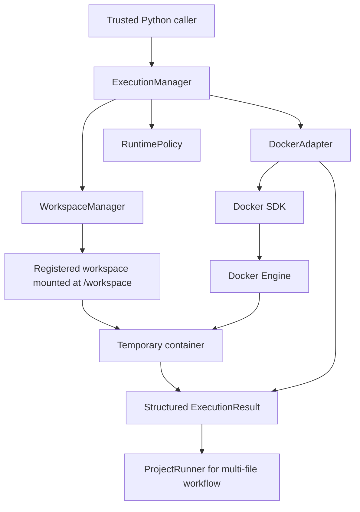

# ARES Master Technical Handover

## A. Document metadata and status

| Field | Value |
|---|---|
| Project | ARES |
| Full title | Agentic AI Execution Management Platform for Reliable Autonomous Software Engineering |
| Purpose | Authoritative technical handover for the implemented repository state |
| Documentation pass | 2026-10-30 |
| Repository | `Lalithaditya007/ARES` |
| Local root | `D:\major\Implementation` |
| Source branch | `feature/phase-3-execution-manager` |
| Intended integration branch | `main` |
| Remote | `origin` → `https://github.com/Lalithaditya007/ARES.git` |
| Current phase | Phase 3: Docker sandbox and Execution Manager |

This document was created from the current source tree, Git state, implementation
files, tests, fixtures, example workspace, and existing Phase 3 records. It
distinguishes current rerun evidence from historical documentation.

### Current verification status

Rerun during this documentation pass:

- Backend suite: `40 passed, 10 skipped, 2 warnings`.
- Real Docker integration suite: `9 passed`.
- Original single-file Docker demonstration: passed with `ARES DEMO PASSED`.
- Multi-file Docker demonstration: passed with `Overall success: True` and
  `ARES MULTI-FILE DEMO PASSED`.
- Frontend build: passed.
- Frontend lint: passed.
- Docker Engine: available, version `28.3.2`, context `desktop-linux`.
- Python: `3.13.13` from `backend\.venv`.
- `pip check`: reports the existing
  `charset-normalizer 3.5.2 is not supported on this platform` warning.
- Git whitespace check: passed.

The Docker integration suite initially encountered a stale-container cleanup
assertion after an interrupted failed run; the stale container was already
gone on inspection, and a clean rerun passed all nine tests. No source change
was made for that transient condition.

At the start of this documentation pass, the feature branch and `main` both
pointed to `12ce742` (`Document Phase 2 cleanup and audit`), and the Phase 3
work was uncommitted. The implementation commit was created as `e39e7f7`
(`feat: implement Phase 3 execution manager`). The final documentation commit,
merge, and push result are recorded in
[Section P](#p-git-changes-release-record-and-handover-instructions) after
release operations.

## B. Executive summary

ARES is intended to provide a reliable execution platform for autonomous
software-engineering workflows. A future ARES workflow will plan a task,
generate or modify code, execute it in a controlled environment, test it,
diagnose failures, apply verified recovery, and preserve useful execution
history.

The completed Phase 3 milestone provides the execution foundation, not the
future agents or recovery system. A caller can register a local workspace,
submit a typed Python or Node.js command, and receive a structured result from
real Docker execution. The container is temporary, network-disabled, non-root,
resource-limited, and cleaned up after execution.

Phase 3 also provides a restricted multi-file project runner. The example
workspace contains two programs and a shared JSON file. `commands.txt` is
parsed as a small allowlist and only `python main.py` and `node app.js` are
accepted. Both programs run through the same `ExecutionManager` and Docker
path.

Not implemented in this milestone are planning/coding/testing/debugging
agents, LangGraph orchestration, public execution endpoints, dependency
installation, persistent execution history, AEKE retrieval, adaptive
recovery, cloud/Kubernetes execution, and production-grade isolation.

The recommended next milestone is to formalize task and execution contracts
for an orchestration layer while keeping every actual execution routed through
the current Execution Manager.

## C. Project history and development timeline

The repository history establishes these commits:

| Commit | Message |
|---|---|
| `c752281` | first commit |
| `81121d8` | Set up Phase 2 development environment |
| `12ce742` | Document Phase 2 cleanup and audit |

The Phase 3 implementation currently resides in the feature worktree and was
not present in the last committed `main` state at the start of this handover.
The existing changelog and test report record the following milestone events:

1. A typed execution contract, workspace registry, runtime policy, Docker
   adapter, and Execution Manager were added.
2. Docker SDK `7.1.0` was added to the backend requirements.
3. Resource controls, network isolation, output limits, timeout handling, and
   cleanup behavior were implemented and tested.
4. Deterministic Python and Node.js fixtures were added and executed through
   the real Docker path.
5. Windows Docker named-pipe timeout behavior was reproduced and handled.
6. The multi-file workspace and restricted `ProjectRunner` were added.
7. Phase 3 tests, manual demonstrations, runbook, decisions, test report,
   changelog, and the reorganized documentation were added.

The current test and documentation folders were later organized under
`tests/phase3-execution-manager/` and `docs/phase3-execution-manager/`.

## D. Architecture and component interaction

### Implemented architecture



The actual call flow is:

1. A caller creates `ExecutionConfig` and `ExecutionManager`.
2. The caller registers a directory through `register_workspace`.
3. A `ProjectRunner` may read `commands.txt` and validate each command, or a
   caller may construct `ExecutionRequest` directly.
4. `ExecutionManager.execute` resolves the registered workspace and applies
   `RuntimePolicy`.
5. The manager pings Docker and prepares the approved image.
6. `DockerAdapter.run` creates a temporary container with the workspace mounted
   read-write at `/workspace`.
7. The container runs the argument-list command as UID/GID `1000:1000`.
8. The adapter waits with the configured timeout, reads stdout/stderr, applies
   the returned-output cap, and removes the container.
9. The caller receives an `ExecutionResult` with status, exit code, output,
   duration, error category, timeout state, truncation state, and cleanup state.

### AEKE clarification

The future Adaptive Execution Knowledge Engine (AEKE) is a knowledge retrieval
and reuse component. It is not an autonomous agent and it is not the component
that directly controls recovery. AEKE is not implemented in Phase 3.

## E. Complete Phase 3 file inventory

The following inventory covers the Phase 3 implementation, tests, fixtures,
examples, configuration, and documentation. Status is relative to the
pre-Phase-3 commit `12ce742`.

| Path | Status | Purpose and relationships |
|---|---|---|
| `backend/app/execution/__init__.py` | Created | Public exports for Phase 3 execution types and services. |
| `backend/app/execution/config.py` | Created | Pydantic configuration for workspace root, approved runtime images, and CPU/memory/process defaults. |
| `backend/app/execution/contracts.py` | Created | Runtime/status/error enums, typed request/result models, validation, and UTF-8 output truncation. |
| `backend/app/execution/docker_adapter.py` | Created | Docker SDK lifecycle, container limits, timeout handling, log retrieval, result mapping, and cleanup. |
| `backend/app/execution/manager.py` | Created | Caller-facing orchestration boundary connecting workspace, runtime policy, image preparation, and Docker execution. |
| `backend/app/execution/project_runner.py` | Created | Restricted `commands.txt` parser and sequential multi-file dispatcher. |
| `backend/app/execution/runtime_policy.py` | Created | Enforces configured Python and Node image allowlists. |
| `backend/app/execution/workspace.py` | Created | Registers existing directories under the approved root and resolves them safely. |
| `backend/requirements.txt` | Modified | Adds `docker==7.1.0` to the existing backend dependencies. |
| `tests/phase3-execution-manager/unit/test_execution_contracts.py` | Created | Contract validation and output truncation tests. |
| `tests/phase3-execution-manager/unit/test_execution_manager.py` | Created | Manager orchestration and failure mapping tests. |
| `tests/phase3-execution-manager/unit/test_docker_adapter.py` | Created | Mocked Docker lifecycle, limits, timeout, log, and cleanup tests. |
| `tests/phase3-execution-manager/unit/test_project_runner.py` | Created | Command allowlist, ordering, failure continuation, and infrastructure-stop tests. |
| `tests/phase3-execution-manager/integration/test_docker_execution.py` | Created | Nine opt-in real-Docker tests for runtimes, workspaces, persistence, failures, timeout, output, cleanup, and multi-file execution. |
| `tests/phase3-execution-manager/fixtures/execution/python/task_summary.py` | Created | Deterministic Python single-file execution fixture. |
| `tests/phase3-execution-manager/fixtures/execution/node/task-summary.js` | Created | Deterministic Node.js single-file execution fixture. |
| `tests/phase3-execution-manager/manual/phase3_execution_demo.py` | Created | Visible single-file Python/Node manager demonstration. |
| `tests/phase3-execution-manager/manual/phase3_multifile_demo.py` | Created | Visible registered-folder, multi-file Docker demonstration. |
| `tests/phase3-execution-manager/README.md` | Created | Test tree, categories, and copyable test commands. |
| `examples/workspaces/ares-multifile-demo/main.py` | Created | Reads shared `tasks.json`, validates records, and reports aggregates in Python. |
| `examples/workspaces/ares-multifile-demo/app.js` | Created | Reads and processes the same shared data independently in Node.js. |
| `examples/workspaces/ares-multifile-demo/tasks.json` | Created | Four-task shared dataset: three completed and one pending. |
| `examples/workspaces/ares-multifile-demo/commands.txt` | Created | Documents the two accepted commands. |
| `docs/ARES_MASTER_HANDOVER.md` | Created | This authoritative handover and index. |
| `docs/phase3-execution-manager/README.md` | Created | Phase 3 documentation map and quickest end-to-end test. |
| `docs/phase3-execution-manager/phase-3-implementation.md` | Created | Focused architecture and implementation guide. |
| `docs/phase3-execution-manager/phase-3-runbook.md` | Created | Setup, PowerShell operations, tests, and troubleshooting. |
| `docs/phase3-execution-manager/phase-3-test-report.md` | Created | Verification evidence, results, warnings, and unverified cases. |
| `docs/phase3-execution-manager/phase-3-decisions.md` | Created | Phase 3 design decisions and rationale. |
| `docs/PROJECT_CHANGELOG.md` | Created | Chronological project and Phase 3 record. |
| `README.md` | Modified | Describes current Phase 3 scope and links to the handover and focused docs. |

The existing frontend, Phase 2 backend, and general setup files were inspected
and verified where applicable; they were not rewritten as part of Phase 3
except for the documented README changes.

## F. Detailed Phase 3 implementation

### Configuration and contracts

`ExecutionConfig` requires a workspace root and defaults to:

- Python: `python:3.10.19-slim-bookworm`
- Node.js: `node:22.14.0-bookworm-slim`
- Memory: `512m`
- CPU: `1.0`
- Processes: `256`

`ExecutionRequest` forbids extra fields, validates a safe workspace identifier,
requires a nonempty argument list, bounds timeout to 900 seconds, and bounds
returned output to 10 MiB. `ExecutionResult` records status, exit code, output,
duration, structured error, timeout, truncation, and cleanup state.

### Workspace registration

`WorkspaceManager` accepts only an existing directory below the configured
workspace root. It resolves both paths and compares `os.path.commonpath` to
reject traversal and resolved symlink escapes. The registry is process-local.
The registered directory is mounted read-write at `/workspace`.

### Runtime and command validation

`RuntimePolicy` selects only the configured image for the requested
`RuntimeFamily`. A caller cannot replace an approved image with an arbitrary
tag.

`ProjectRunner` is intentionally narrower than a shell. It accepts only:

```text
python main.py
node app.js
```

Blank lines and full-line comments are ignored. Extra arguments, path
traversal, shell operators, redirects, chaining, shell launchers, and unknown
commands are rejected. Commands execute sequentially through the existing
manager; normal command failures are collected and execution continues, while
timeouts, validation, image, Docker, and cleanup failures stop the workflow.

### Docker execution

`DockerAdapter` creates a temporary container with:

- The registered workspace mounted only at `/workspace`.
- Working directory `/workspace`.
- User `1000:1000`.
- Networking disabled.
- All Linux capabilities dropped.
- `no-new-privileges:true`.
- Configured memory, CPU, and process limits.
- No privileged mode, host devices, Docker socket, host namespace, or broad
  host mount.

It prepares images explicitly, waits for completion, reads stdout/stderr,
truncates returned UTF-8 output at the request limit, recognizes wrapped
Windows named-pipe timeout errors, stops timed-out containers, and removes
containers in cleanup. Cleanup failure becomes a distinct result state.

## G. Multi-file project workflow

The example at
`examples/workspaces/ares-multifile-demo/` contains:

| File | Role |
|---|---|
| `main.py` | Python program that reads and validates `tasks.json`. |
| `app.js` | Node.js program that independently reads and validates `tasks.json`. |
| `tasks.json` | Shared four-task dataset. |
| `commands.txt` | Two-line allowlist input: `python main.py` and `node app.js`. |

The manual script registers the host folder under the approved workspace root,
creates `ProjectRunner`, reads the command file, and sends both commands
through the same manager and Docker adapter. This proves a mounted multi-file
project workflow: both programs access a sibling shared data file in the
mounted workspace rather than receiving isolated source strings.

Current observed output for both programs:

```text
Total tasks: 4
Completed tasks: 3
Pending tasks: 1
Completion: 75.00%
Invalid record handled: True
```

Run it with:

```powershell
.\backend\.venv\Scripts\python.exe tests\phase3-execution-manager\manual\phase3_multifile_demo.py
```

Expected ending:

```text
Python result: PASS
Node result: PASS
Overall success: True
ARES MULTI-FILE DEMO PASSED
```

## H. Dependency and environment record

The current verified environment is:

- Windows.
- Python `3.13.13`.
- Canonical interpreter: `.\backend\.venv\Scripts\python.exe`.
- Docker Desktop with WSL2-backed `desktop-linux` context.
- Docker Engine `28.3.2`.
- Docker SDK `7.1.0`.
- Pinned images listed in [Section F](#f-detailed-phase-3-implementation).

Backend dependencies are declared in `backend/requirements.txt`. Frontend
dependencies and scripts are declared in `frontend/package.json`; the frontend
uses npm and supports `build` and `lint`.

The current environment check is:

```text
pip check:
charset-normalizer 3.5.2 is not supported on this platform
```

This warning was not blindly fixed because the tested execution paths pass.
Historical Phase 3 records also document a local force-reinstall of the
already-required `pywin32==312` wheel to repair Windows Docker named-pipe
imports. That was an environment repair, not a new application dependency.

## I. Exact setup and operation runbook

From `D:\major\Implementation`:

```powershell
.\backend\.venv\Scripts\python.exe --version
docker --version
docker info
```

If the environment is not installed:

```powershell
Set-Location backend
python -m venv .venv
.\.venv\Scripts\Activate.ps1
python -m pip install -r requirements.txt
Set-Location ..
```

The canonical commands should use `backend\.venv`; do not use the root
`.venv`.

Run the manual demonstrations:

```powershell
.\backend\.venv\Scripts\python.exe tests\phase3-execution-manager\manual\phase3_execution_demo.py
.\backend\.venv\Scripts\python.exe tests\phase3-execution-manager\manual\phase3_multifile_demo.py
```

Run unit tests:

```powershell
.\backend\.venv\Scripts\python.exe -m pytest -q tests\phase3-execution-manager\unit tests\test_health.py
```

Run real Docker tests without permanently changing the PowerShell environment:

```powershell
$previousDockerGate = $env:ARES_RUN_DOCKER_TESTS
try {
    $env:ARES_RUN_DOCKER_TESTS = "1"
    .\backend\.venv\Scripts\python.exe -m pytest -q tests\phase3-execution-manager\integration
} finally {
    if ($null -eq $previousDockerGate) {
        Remove-Item Env:ARES_RUN_DOCKER_TESTS -ErrorAction SilentlyContinue
    } else {
        $env:ARES_RUN_DOCKER_TESTS = $previousDockerGate
    }
}
```

Run the complete backend suite:

```powershell
.\backend\.venv\Scripts\python.exe -m pytest -q
```

Run frontend checks from the frontend directory:

```powershell
Set-Location frontend
npm run build
npm run lint
Set-Location ..
```

If Docker tests are skipped, set `ARES_RUN_DOCKER_TESTS` only inside the
temporary block above. If Docker is unavailable, start Docker Desktop and
confirm `docker info`. If an image is missing, the manager may pull the pinned
image during explicit preparation and therefore needs registry access.

## J. Testing and verification ledger

| Category | Command | External service | Current evidence |
|---|---|---:|---|
| Complete backend suite | `.\backend\.venv\Scripts\python.exe -m pytest -q` | No | **Rerun now:** 40 passed, 10 skipped, 2 warnings |
| Phase 3 unit tests | `.\backend\.venv\Scripts\python.exe -m pytest -q tests\phase3-execution-manager\unit tests\test_health.py` | No | **Rerun now:** 40 passed, 1 skipped, 2 warnings |
| Docker integration | Temporary `ARES_RUN_DOCKER_TESTS=1` block targeting `tests\phase3-execution-manager\integration` | Docker | **Rerun now:** 9 passed |
| Single-file manual demo | `tests\phase3-execution-manager\manual\phase3_execution_demo.py` | Docker | **Rerun now:** passed |
| Multi-file manual demo | `tests\phase3-execution-manager\manual\phase3_multifile_demo.py` | Docker | **Rerun now:** passed |
| Frontend production build | `Set-Location frontend; npm run build` | No | **Rerun now:** passed |
| Frontend lint | `Set-Location frontend; npm run lint` | No | **Rerun now:** passed |
| Dependency check | `.\backend\.venv\Scripts\python.exe -m pip check` | No | **Rerun now:** existing charset-normalizer warning |
| Docker connectivity/images | `docker info`, context and image inspection | Docker | **Rerun now:** Engine 28.3.2, images available |
| Diff whitespace | `git diff --check` | No | **Rerun now:** passed |

Historical records also report a final Docker-enabled backend result of
`49 passed, 1 skipped, 2 warnings` before the test reorganization. The current
rerun of the reorganized tree is the authoritative current count above.

## K. Security and safety model

The implementation limits host exposure through explicit workspace
registration, resolved-path containment, a single `/workspace` bind mount, and
an allowlisted runtime image policy. Project containers run without network,
as a non-root UID/GID, with all capabilities dropped and
`no-new-privileges`. CPU, memory, process, timeout, and returned-output limits
are applied. Temporary containers are removed after execution.

Command validation prevents the multi-file runner from becoming an arbitrary
shell. There is no `shell=True`, shell launcher, pipe, redirect, command
chaining, privileged mode, Docker socket mount, host namespace, or host device
configuration in the Phase 3 path.

These are risk-reduction controls, not a perfect security boundary. Docker
containers share the host kernel, the workspace is read-write, the registry is
process-local, and output truncation occurs after log retrieval rather than as
a streaming memory bound. Do not mount the host Docker socket into an
untrusted project container or run project containers in privileged mode.

## L. Design decisions and rationale

- **Registered workspaces:** explicit registration provides a bounded,
  auditable host path and avoids accepting arbitrary request paths.
- **Execution Manager boundary:** future agents have one stable execution API
  and do not control Docker directly.
- **Docker adapter separation:** Docker-specific lifecycle and error handling
  remain separate from orchestration and policy decisions.
- **Pinned image allowlist:** avoids `latest` drift and arbitrary runtime
  selection.
- **Deferred dependency installation:** avoids silently running package
  lifecycle scripts, credentials, or network access without an explicit
  policy.
- **Disabled project networking:** reduces exfiltration and non-deterministic
  execution risk.
- **Restricted command grammar:** demonstrates multi-file execution without
  introducing unrestricted shell execution.
- **Explicit failure and cleanup states:** normal program failure is distinct
  from infrastructure failure, timeout, and cleanup failure.

The focused records are [phase-3-decisions.md](phase3-execution-manager/phase-3-decisions.md)
and [phase-3-implementation.md](phase3-execution-manager/phase-3-implementation.md).

## M. Known limitations and deferred scope

### Functional gaps

- No automatic dependency installation or package-manager workflow.
- No persistent workspace lifecycle or execution history.
- No public HTTP execution endpoint.
- Only the configured Python and Node.js runtime images are supported.
- Project command grammar is intentionally limited.

### Security and operational limitations

- Docker is a shared-kernel boundary, not a perfect sandbox.
- Workspace registration is process-local and cannot eliminate every filesystem
  race.
- Returned-output truncation is not bounded streaming log collection.
- Docker Desktop host warnings require separate host review.
- Production quotas, concurrency controls, audit logging, credentials, and
  stronger isolation are deferred.

### Explicitly future

LangGraph orchestration, Planning/Coding/Testing/Debugging agents, PostgreSQL
execution memory, AEKE retrieval/reuse, adaptive recovery and retry policies,
cloud/Kubernetes execution, and production deployment hardening are not
implemented in Phase 3.

## N. Troubleshooting guide

| Symptom | Safe diagnostic or response |
|---|---|
| Docker is not running | Start Docker Desktop, then run `docker info`. |
| Docker named-pipe error | Verify `win32file`/`win32pipe` imports and the Docker SDK installation; the historical local repair was a force-reinstall of `pywin32==312`. |
| Wrong Python environment | Use `.\backend\.venv\Scripts\python.exe`; do not substitute the root `.venv`. |
| Docker tests skipped | Set `ARES_RUN_DOCKER_TESTS=1` only in the documented `try/finally` block. |
| Image preparation failure | Confirm the exact pinned tag and registry access. |
| Invalid workspace | Register an existing directory below the configured workspace root. |
| Rejected project command | Use only `python main.py` or `node app.js`; no shell operators or extra arguments. |
| Nonzero exit | Inspect the returned `status`, `exit_code`, and stderr; this is a command failure, not automatically an infrastructure failure. |
| Timeout | Keep bounded timeouts; inspect cleanup and split long-running work rather than removing limits. |
| Cleanup failure | Treat it as an infrastructure/safety issue and inspect Docker state before retrying. |
| Frontend command fails with missing package.json | Run npm commands after `Set-Location frontend`. |
| `pip check` warning | Record the current compatibility warning; do not blindly alter dependencies when tested execution passes. |

## O. Current project status and next milestones

Phase 3 establishes a working, tested local execution foundation and a
realistic registered-folder workflow. The next incremental path should be:

1. Formalize task and execution contracts for callers.
2. Add planning and generated-code interfaces without bypassing the manager.
3. Support controlled execution of generated project changes.
4. Interpret test results through structured contracts.
5. Add failure diagnosis and verified repair policies.
6. Add persistent execution history and AEKE retrieval/reuse.
7. Integrate the dashboard and broader API surface.

These are recommendations, not completed functionality.

## P. Git changes, release record, and handover instructions

### Release context

At inspection time:

- Source branch: `feature/phase-3-execution-manager`.
- Target branch: `main`.
- Remote: `origin` at the repository URL in Section A.
- Both branches pointed to `12ce742`.
- Phase 3 implementation and documentation were uncommitted.
- No unrelated user changes were identified in the worktree.

The release record below must be updated with the actual results after commit
and merge. It must never be inferred from intent.

| Item | Result |
|---|---|
| Implementation commit | `e39e7f7` — `feat: implement Phase 3 execution manager` |
| Documentation commit | `c40d1dd` — `docs: add comprehensive ARES Phase 3 handover` |
| Release-record commit | Pending final documentation update |
| Feature branch pushed | Confirmed: `origin/feature/phase-3-execution-manager` |
| Merge into `main` | Confirmed fast-forward: `12ce742` → `f5717cc` |
| Main branch pushed | Confirmed: `origin/main` at `f5717cc` |
| Final status | Pending final documentation update |

### Start Here for the next conversation

1. Read this file first.
2. Read the linked [Phase 3 index](phase3-execution-manager/README.md),
   [implementation guide](phase3-execution-manager/phase-3-implementation.md),
   [runbook](phase3-execution-manager/phase-3-runbook.md), [decisions](phase3-execution-manager/phase-3-decisions.md),
   and [test report](phase3-execution-manager/phase-3-test-report.md).
3. Check `git status --short --branch`, branch, remote, and recent history
   before changing anything.
4. Verify code and tests before making claims; treat this handover as the
   primary index, not as a substitute for source inspection.
5. Continue from the existing implementation. Do not recreate completed Phase
   3 work.
6. Keep deferred features deferred until explicitly requested.
